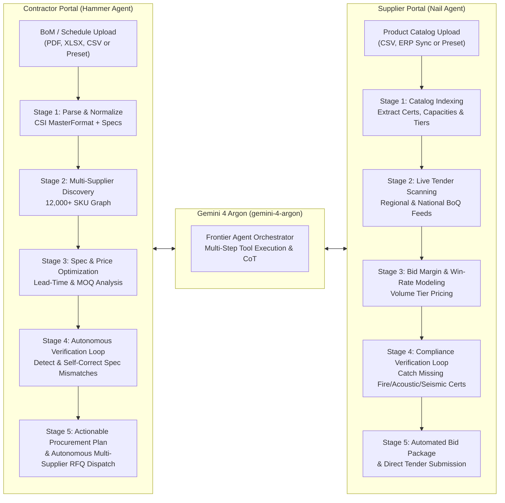

# Hammer&Nail — Dual-AI Construction Procurement Platform

[](https://jojospahrep.github.io/hammer-and-nail/)
[](https://github.com/jojospahrep/hammer-and-nail)
[](./LICENSE)

**Hammer&Nail** is a Dual-AI B2B construction procurement platform powered by **Gemini 4 Argon (`gemini-4-argon`) Frontier Agents**. It bridges general contractors and construction material suppliers through two specialized, autonomous multi-step AI agents that execute deep technical specification matching, automated verification loops, self-correction of non-compliant materials, and autonomous Request for Quotation (RFQ) / tender bid generation.

🔗 **Live Interactive Web App:** [https://jojospahrep.github.io/hammer-and-nail/](https://jojospahrep.github.io/hammer-and-nail/)  
📦 **GitHub Repository:** [https://github.com/jojospahrep/hammer-and-nail](https://github.com/jojospahrep/hammer-and-nail)

---

## Architecture Overview: Dual-AI Frontier Agents

Hammer&Nail operates two complementary portals backed by autonomous **Gemini 4 Argon (`gemini-4-argon`)** reasoning pipelines:



### 1. Hammer Agent (Contractor Portal)
Designed for General Contractors, Quantity Surveyors, and MEP/Structural Engineers:
- **Multi-Format BoM Ingestion**: Upload any Bill of Materials (`.xlsx`, `.csv`, `.pdf`, `.txt`, `.json`) or one-click load 4 real-world construction projects.
- **Autonomous Spec & Compliance Verification Loop**: Before finalizing any recommendation, the Hammer Agent runs a strict verification pass across fire ratings (`UL 10C`, `EN 13501-1`), structural grades (`ASTM A992`, `BS EN 10025 S355JR`), and acoustic ratings (`STC`/`Rw`). If a cheaper candidate fails a project constraint, the agent **autonomously flags and self-corrects** the selection in real time.
- **Interactive Supplier Comparison**: Switch between **Best Match**, **2nd Best**, and **3rd Best** verified suppliers on every line item and watch the total projected budget, savings percentage, and compliance score update dynamically.
- **Autonomous Multi-Supplier RFQ Dispatch**: Generate formal, standards-referenced RFQ packages with target pricing and Incoterms (`DDP Project Site`) and dispatch them across all matched suppliers in one click.

### 2. Nail Agent (Supplier Portal)
Designed for Construction Material Manufacturers, Distributors, and Fabricators:
- **Catalog Ingestion & Semantic Indexing**: Upload a product catalog or select from 3 pre-loaded manufacturer catalogs.
- **Live Contractor Tender Matching**: Scans active regional and national contractor BoQs to identify high-margin line items matching your exact factory certifications and stock capacity.
- **Pre-Bid Compliance Verification Loop**: Automatically checks whether your SKU satisfies all mandatory tender clauses (e.g., seismic bracing certifications, LEED v4.1 EPD requirements, fire-rated assembly certificates) and auto-attaches required test reports or flags exclusions prior to bid submission.
- **Autonomous Tender Bid Submission**: Draft and submit binding commercial proposals with customizable unit bid prices, volume discounts, and guaranteed delivery lead times.

---

## Pre-Loaded Construction Projects & Supplier Catalogs

You can test the platform immediately with zero setup using the built-in datasets:

### Pre-Loaded Contractor Projects (BoMs)
| Project ID | Project Name | Location | Total Budget | Line Items | Key Technical Standards |
| :--- | :--- | :--- | :--- | :--- | :--- |
| `PRJ-2026-089` | ** Marina Bay Commercial Tower — Level 14–28 Fit-Out** | Downtown Core | \$68,450+ | 6 Core Packages | `EN 13501-1 A2-s1,d0`, `STC 52`, `UL 10C 90-Min`, `BS EN 14351-1` |
| `PRJ-2026-104` | **Apex Hyperscale Data Center — Phase II MEP & Structural** | North Tech Park | \$194,200+ | 4 Core Packages | `ASTM A992 Gr.50`, `FM Approved PIR`, `UL 94 V-0`, `IEEE 383` |
| `PRJ-2026-118` | **St. Jude Regional Medical Center — Acute Wing Expansion** | West Healthcare District | \$82,900+ | 4 Core Packages | `NFPA 99 Medical Gas`, `ASTM E84 Class A`, `HTM 02-01`, `ISO 14644-1` |
| `PRJ-2026-132` | **Harborview Eco-Residences — Mass Timber & Facade Envelope** | Waterfront District | \$115,600+ | 4 Core Packages | `ANSI/APA PRG 320 CLT`, `FSC 100%`, `PassiveHouse U ≤ 0.80` |

### Pre-Loaded Supplier Catalogs
| Catalog ID | Supplier Name | Specialization | Active SKUs | Matched Tenders |
| :--- | :--- | :--- | :--- | :--- |
| `CAT-SUP-01` | **Apex Architectural & Acoustic Systems** | Acoustic Ceilings, Partition Systems & Glazing | 4 Core SKUs | 5 Active Regional Tenders |
| `CAT-SUP-02` | **Titan Structural Steel & Fire Doors Co.** | Structural H-Beams, Rebar & Fire-Rated Assemblies | 3 Core SKUs | 4 Active Regional Tenders |
| `CAT-SUP-03` | **VoltGuard MEP & Critical Power Supply** | LSZH Cabling, Busways & Precision HVAC Controls | 3 Core SKUs | 4 Active Regional Tenders |

---

## Gemini 4 Argon (`gemini-4-argon`) Engine Integration

Hammer&Nail is engineered around **`gemini-4-argon`** (`gemini-4-argon-preview-0415`) with seamless multi-mode execution:
1. **Live API Mode**: Click the **Gemini 4 Argon (`gemini-4-argon`)** status pill in the top navigation bar (or inspect the **Frontier Agent Reasoning Trace** drawer) to enter a Gemini API Key, select reasoning depth (`high` / `medium`), and run live LLM calls directly from the browser or via the Express backend (`/api/agent/*`).
2. **Deterministic Frontier Agent Simulation Mode**: Works out-of-the-box on static hosts (including GitHub Pages) with full 5-stage reasoning traces, tool call payloads (`parse_bom_document`, `query_supplier_graph`, `verify_material_compliance`, `optimize_bundle_allocation`), and autonomous self-correction logs.

### Backend API Endpoints ([`server/index.ts`](./server/index.ts))
- `GET /api/health` — Returns engine status, model identifier (`gemini-4-argon`), and active capabilities.
- `POST /api/agent/run` — Executes the 5-stage autonomous Frontier Agent loop (Ingestion → Discovery → Optimization → Verification Loop → Final Synthesis) for either the `contractor` (**Hammer Agent**) or `supplier` (**Nail Agent**) portal.
- `POST /api/agent/parse-bom` — Parses natural-language project briefs or uploaded CSV/text files into structured, CSI-coded BoQ line items with matched suppliers and verification audits.
- `POST /api/agent/generate-rfq` — Generates formal multi-supplier RFQ packages or supplier tender bid proposals using `gemini-4-argon`.

---

## Project Structure

```text
hammer-and-nail/
├── docs/                                   # Production build served by GitHub Pages
├── server/
│   ├── index.ts                            # Express API server + Gemini 4 Argon orchestrator
│   └── geminiArgonEngine.ts                # Server-side multi-step reasoning & verification engine
├── src/
│   ├── components/
│   │   ├── FrontierAgentTracePanel.tsx     # Live 5-stage reasoning trace, verification loop & RFQ/Bid modals
│   │   ├── LandingAndProfilePages.tsx      # Animated landing page & verified supplier profile view
│   │   └── PortalShared.tsx                # Dual-portal switcher, search/upload bar & project/catalog selectors
│   ├── data/
│   │   └── constructionData.ts             # Pre-loaded construction projects, BoMs, supplier catalogs & profiles
│   ├── services/
│   │   └── agentClient.ts                  # Client-side Gemini 4 Argon API client + offline Frontier fallback
│   ├── App.tsx                             # Main application state, Contractor & Supplier portals, BOQ table
│   ├── index.css                           # Tailwind CSS + custom animations & typography
│   └── main.tsx                            # React 18 entry point
├── index.html
├── package.json
├── tailwind.config.js
└── vite.config.ts
```

---

## Local Development & Build

### Prerequisites
- Node.js `v18+` and `npm`

### 1. Install Dependencies
```bash
npm install
```

### 2. Start the Full-Stack Server (Express + Vite Bundle on Port `8788`)
```bash
# Optionally provide a Gemini API key in your environment:
export GEMINI_API_KEY="your-api-key-here"

npm start
```
Then open `http://localhost:8788` in your browser.

### 3. Run Vite Dev Server (Hot Reload)
```bash
npm run dev
```

### 4. Build for Production / GitHub Pages
```bash
npm run build
cp dist/index.html dist/404.html
touch dist/.nojekyll
rm -rf docs && cp -R dist docs
```

---

## License
Released under the MIT License.
